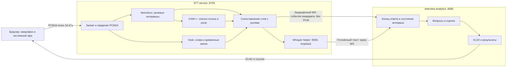
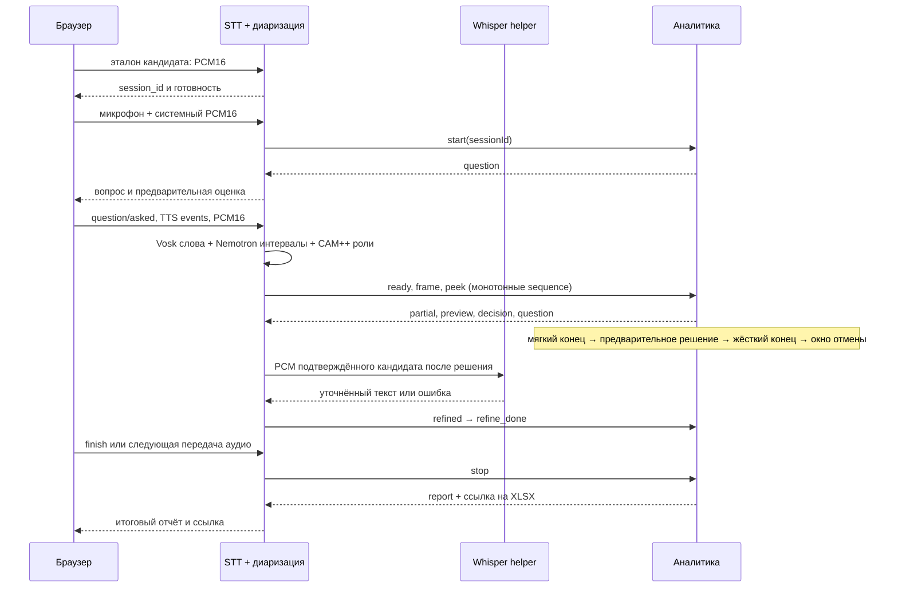

# Архитектура STT и аналитики

## Границы сервисов

Локальный скрипт запускает внутренний Whisper helper отдельным процессом на loopback, но это часть контура STT: браузер и аналитика с ним не общаются. В распределённом развёртывании STT и аналитика остаются двумя сервисами; локальный helper следует размещать только рядом с STT.

## Как объединены Vosk и диаризация

1. Браузер смешивает микрофон и системный звук в моно PCM16 16 кГц. Один поток с абсолютной шкалой сэмплов поступает в Nemotron и в непрерывный Vosk recognizer смешанного звука.
2. Nemotron выдаёт временные интервалы говорящих. CAM++ сравнивает эмбеддинги с эталоном кандидата; остальные устойчивые ID говорящих становятся интервьюерами, без заранее записанного эталона интервьюера. Пока накоплено недостаточно подтверждений, роль может быть предварительной или «не определено».
3. Для каждого слова Vosk используются `start`/`end` относительно начала потока. `IntegrationBridge` переводит их в общую шкалу сэмплов и вычисляет пересечение слова с интервалами ролей. Роль слова считается однозначной, если одна роль покрывает не менее половины длительности слова и другая роль не занимает 75% или больше от лучшего пересечения. В остальных случаях слово остаётся «не определено».
4. В очередь аналитического распознавания пропускается только аудио с **подтверждённой ролью кандидата**. Звук интервьюера, перекрывающаяся речь, предварительные интервалы и звук до события READY заменяются нулями. Пока диаризация уточняет последние интервалы, удерживается хвост потока около одной секунды; незакрытый интервал говорящего также задерживает выдачу последующих блоков.
5. Предварительная роль может использоваться для запроса `peek`: аналитика рассчитывает только read-only подсказку. Это не фиксирует ответ и не меняет текущий вопрос. При изменении роли подсказка отзывается.
6. Отдельный Vosk recognizer получает уже отфильтрованные кадры кандидата. Его промежуточный и финальный текст, число сэмплов, RMS-энергия и время обработки передаются аналитике событиями. Сырые аудиокадры по внутреннему WebSocket не отправляются.
7. После решения STT передаёт сохранённый звук кандидата локальному Whisper helper. Если Whisper вернул текст, STT отправляет `refined`, затем `refine_done`; аналитика повторно считает оценку того же ответа. Если Whisper выключен или завершился ошибкой, STT всё равно отправляет `refine_done`, чтобы отчёт не ждал до тайм-аута.

CAM++ предварительно сравнивает голос с порогом, заданным `--threshold` (по умолчанию `0.60`), и требует разницу оценок кандидата/интервьюера. Для устойчивой роли используется накопление не менее 2,5 секунд свидетельств. В интерфейсе предварительная метка показывается только после повторных совпадений; она никогда не открывает поток аудио для изменения состояния аналитики.

## Поток интервью и состояния

Аналитика сохраняет прежний сценарий решения: мягкий конец ответа подготавливает предварительное решение; жёсткий конец принимает его после дополнительной паузы; окно grace позволяет отозвать решение при продолжении речи. `retract` возвращает интервью к прежнему вопросу. Уточнение текста не задерживает решение, но аналитика может ждать завершения уточнений до `interview.refinement-wait-ms` перед XLSX-отчётом.

## Внутренний канал и отказоустойчивость

STT подключается к `ws://127.0.0.1:8080/ws/interview-events` с заголовком `X-Internal-Token`. Секрет `INTERVIEW_EVENTS_TOKEN` должен совпадать у обоих процессов и иметь не менее 32 символов. Локальный сценарий создаёт случайный секрет сам. При развёртывании на разных узлах передавайте секрет через менеджер секретов, ограничьте сетевой доступ и используйте TLS (`wss`).

Первое сообщение `start` содержит `sessionId`. Все последующие сообщения STT → analytics несут тот же ID и возрастающий `sequence`, начиная с 1. Каждое событие с аудио привязывает границы к абсолютной шкале 16 кГц в `audioStartSample`/`audioEndSample`; уточнение и его завершение дополнительно используют `answerId`. Сообщения analytics → STT имеют собственную последовательность и `audioSample` как водяной знак потока. Дубликат с уже пройденным номером игнорируется; пропуск номера, неверная сессия или неизвестный тип завершают соединение с policy violation. Схемы сообщений и примеры приведены в [справочнике WebSocket](api/interview-events.md).

Очереди STT ограничены. Переполнение очереди смешанного потока останавливает сессию; переполнение очереди кандидата фиксируется в `integration-summary.json` и пропущенные интервалы не восстанавливаются. Для диагностики сохраняются JSONL-события, общая временная шкала и итоговая сводка. Точность ролей и распознавания зависит от качества эталона, микрофона, перекрытия голосов, моделей и нагрузки.

## Прежние WebSocket-маршруты

Старые `/ws/stt` и `/ws/interview` относились к монолитному приложению: аналитика сама открывала Vosk и принимала аудио. В новой схеме они удалены из аналитики. Браузер отправляет аудио по локальному HTTP API STT, а STT передаёт аналитику только события и распознанный текст. Описание текущих HTTP-маршрутов находится в [OpenAPI STT](api/stt.openapi.yaml) и [OpenAPI analytics](api/analytics.openapi.yaml).
